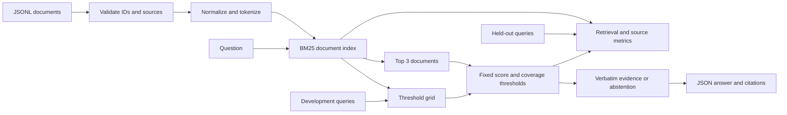

# Architecture and evaluation protocol

## Retrieval

BM25 uses `k1=1.5`, `b=0.75` and smoothed positive inverse document frequency. Tokens are Unicode-normalized, lowercased and accent-insensitive. A small English/French stop list avoids treating function words as evidence. Ties break on stable document ID. Each JSONL record is one short retrieval unit; no hidden chunking occurs.

Top-hit lexical coverage is the fraction of distinct query tokens present in that hit. A question is answered only when both its BM25 score and lexical coverage pass the development-selected thresholds. The answer is the source sentence with the most query-token matches. The citation quotes exactly that sentence.

## Evaluation

Ten development queries select one of sixteen threshold pairs, maximizing correct source choice or correct abstention. Ties prefer the larger coverage threshold, then larger score threshold. The sixteen test queries are disjoint by ID and exact case-insensitive query text. The test set is never an input to threshold selection.

Recall@3 and MRR@3 are computed on answerable queries. Answer-source accuracy counts answered questions whose cited document appears in the labeled relevant IDs; incorrect answers to unanswerable queries count as failures. Coverage is the fraction of all questions answered. The rejection metric uses only unanswerable queries.

The benchmark intentionally measures source retrieval and rejection, not sentence-level entailment, factual completeness, reasoning or generated-answer faithfulness. A verbatim sentence can be true but fail to answer the question. The post-hoc challenge set in `data/challenge.jsonl` demonstrates this failure and is documented separately. A future LLM adapter should be evaluated separately and must not inherit the baseline's measured scores.

## Reproducibility

No randomness, network or external model is involved. Reports include a SHA-256 of the canonical serialized document objects. Content edits change this fingerprint. CI reruns the tests and benchmark, but this repository makes no claim that a GitHub-hosted CI run has succeeded until GitHub reports it.
